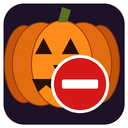

# Silence Horseman

During Hallow's End the Shade of the Horseman yells in the zone every couple of minutes, and the Headless Horseman has plenty to say in the Scarlet Monastery. Silence Horseman turns them off, and each part is its own checkbox:

- **Mute his voice lines**: silences the Horseman's voice files (50 of them), so his yells and boss lines make no sound.
- **Hide his chat text**: removes his yells, says and emotes from every chat window.

Both are on by default. Nothing else is touched: other NPCs, music and sound effects play as normal.

## Use
`/shh` opens the options. From chat:

- `/shh audio on|off`
- `/shh chat on|off`
- `/shh status`
- `/shh debug on|off`: prints one line for each NPC yell it sees (speaker, hidden or shown, seconds since that speaker last spoke), useful for finding out how often an event repeats.

`/silencehorseman` works too.

## Install
Copy the `SilenceHorseman` folder into `World of Warcraft\_anniversary_\Interface\AddOns` (or the folder of the client you play) and restart the game or `/reload`.

## Notes
- Written for the TBC Anniversary client (interface 20506); other Classic-era clients are untested.
- The chat filter matches any speaker whose name contains "Horseman", so it is English only.
- The voice file IDs come from the community listfile. If you still hear him, open an issue with what you heard and where.
- It saves its two settings account-wide in `SilenceHorsemanDB`. It collects and sends nothing.

## License
MIT, see `LICENSE`.
